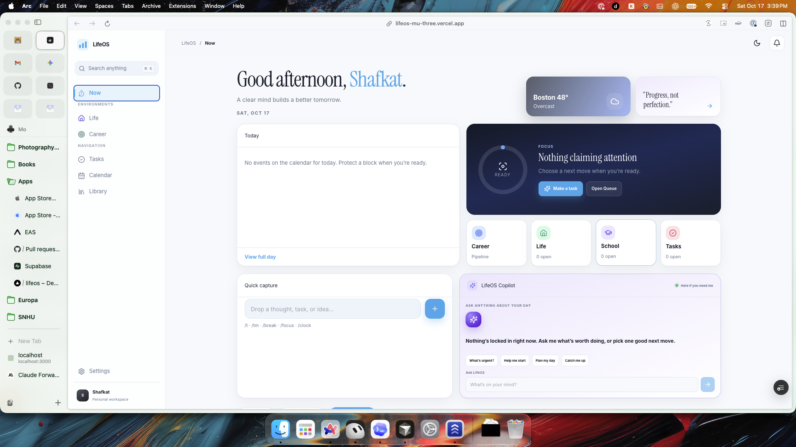

# LifeOS design archive — pre-lock snapshot (2026-10)

Frozen reference of how LifeOS looked **before** locking the Atelier / Now redesign.
Keep this so we can restore or compare without guessing.

## Brand mark (sidebar)

- **Previous (locked earlier this week):** black tile `#111`, white bars (heights 6 / 11 / 8).
- **At the moment of this archive request:** same bar geometry; fill/background may flip to white tile + black bars per product request — see `app/globals.css` `.brand-mark`.
- Markup: three `` bars inside `.brand-mark` (see sidebar in `app/page.tsx`).

## Now surface (Atelier)

- Greeting + date, weather + quote, large Focus card, hub strip under Focus, Today calendar card, Copilot.
- Hub strip order (current product rule): **Home → one enabled hub → Calendar → Tasks**; if no extra hubs, **Library** fills the last slot; Calendar/Tasks replace additional hubs.
- Quick-capture chips (Daily reset / Weekly review / Plan today) and the large Quick Capture card were removed from Now before this archive.

## Sidebar

- Environments: Life (display **Home**), Work, Career, School, Study Abroad, Treasury, Mastery (gated by hub toggles / Pro).
- Navigation: Tasks, **Navigation** (opens Executive Function panel), Calendar, Library.
- Executive Function previously lived as a strip on Now (`ExecutiveActiveStrip`); moved into the sidebar as **Navigation**.

## Typography (at archive time)

- Body: Inter (local woff2 in `app/fonts/`).
- Display: Instrument Serif (Google).
- Pending product request: sole font `SFProDisplay-Medium.ttf` across browsers (requires shipping the TTF; Apple system SF Pro is a Mac/iOS-only fallback).

## Key files

| Area | Path |
|------|------|
| Shell / Now / nav | `app/page.tsx` |
| Tokens / brand / Now layout | `app/globals.css` |
| Executive panel | `app/components/ExecutivePanel.tsx` |
| Favicon | `public/favicon.svg` |
| Design notes | `docs/design-system.md` |

## Screenshot reference

User-provided Now screenshot (Arc, Mac): Focus card, hub strip, Today, Copilot.
